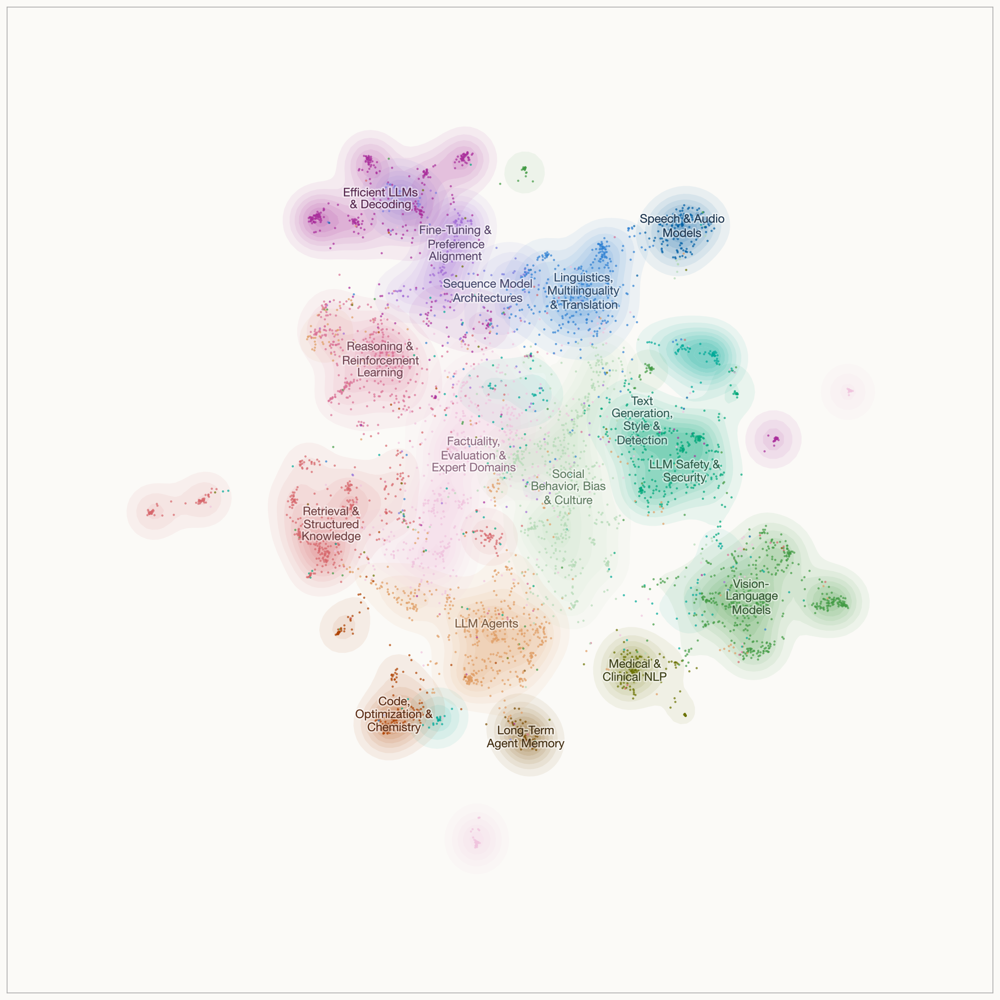
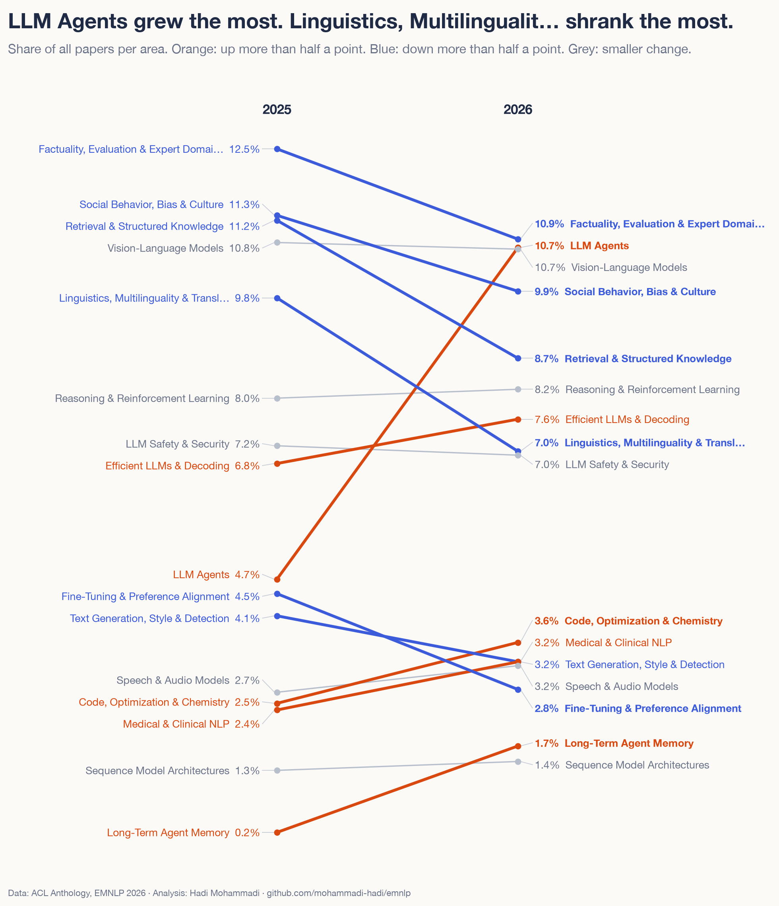
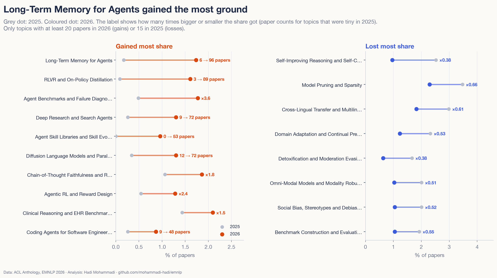
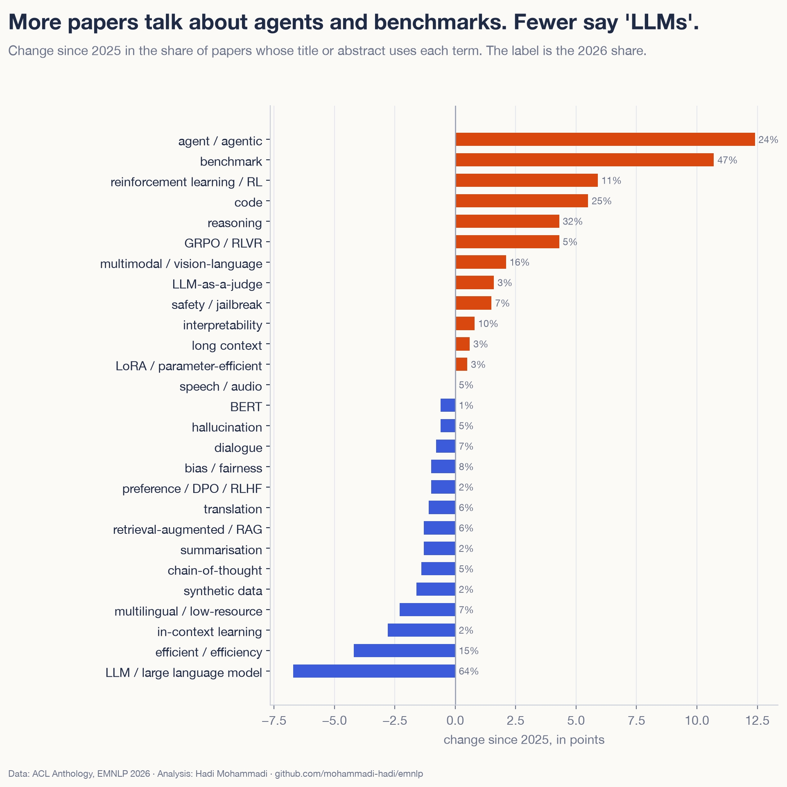
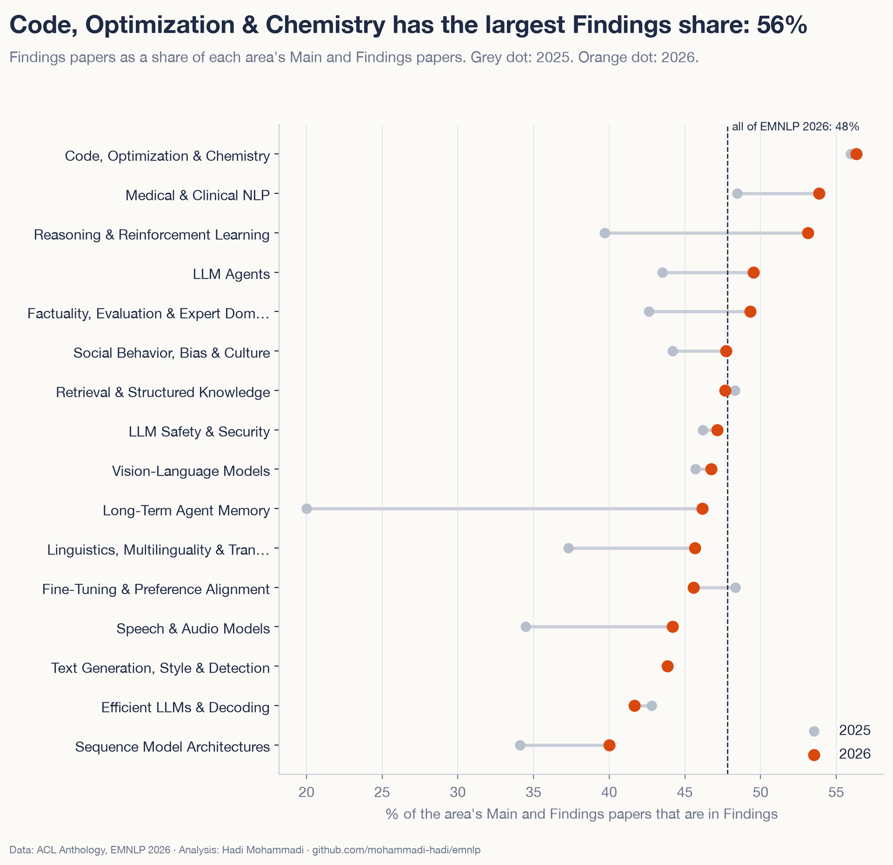
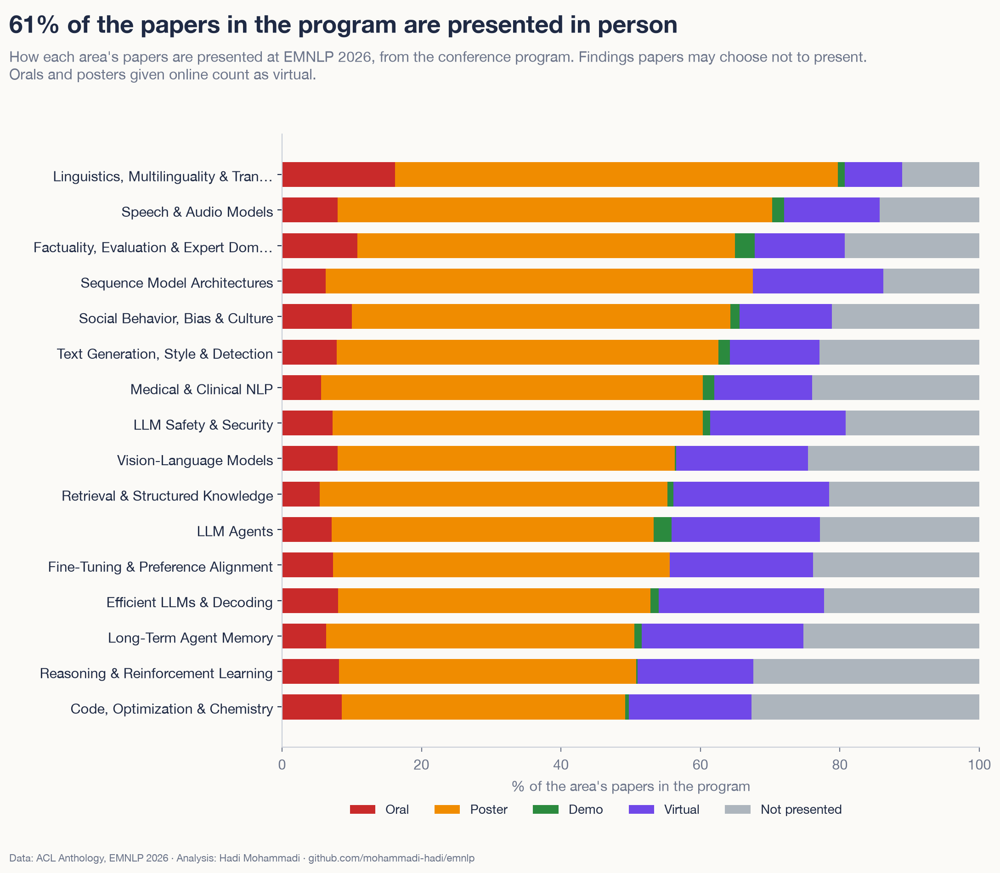
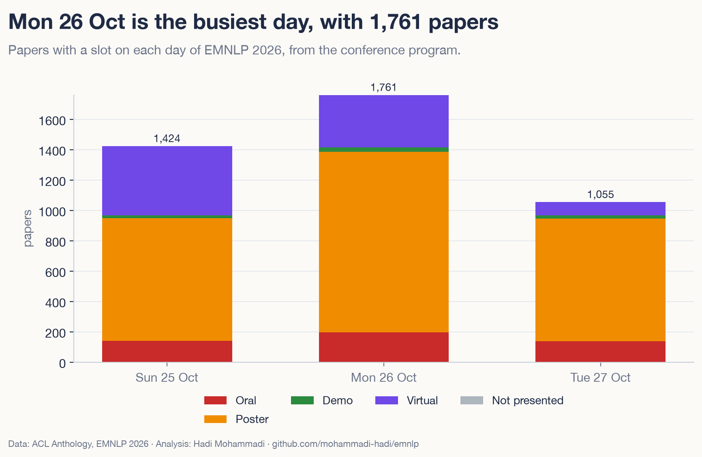

<!-- dek: Every EMNLP 2026 paper on one map, and what changed since 2025. -->
<!-- date: 22 October 2026 -->

# What 5,534 EMNLP 2026 papers are about

EMNLP 2026 in Budapest has 5,534 papers, 59% more than in 2025. I put every one of them on one map and compared them with the 3,484 papers from last year.

The big story is agents. One in four papers now mentions them, twice as many as last year.

<!-- atlas-hero -->
**[Open the map of all 5,534 papers →](https://mohammadi.cv/emnlp/2026/atlas.html)**

## Seven things that stood out

1. Papers that mention agents went from 12% to 25% of EMNLP. The LLM agents area alone went from 165 papers to 594.
2. Memory for agents gained the most ground. It had 6 papers in 2025 and has 96 now.
3. Reinforcement learning with verifiable rewards (RLVR) arrived. That topic went from 3 papers to 89, and "GRPO" or "RLVR" now shows up in 5% of abstracts.
4. "Benchmark" is in 47% of titles and abstracts, up from 37%.
5. Some classic NLP areas shrank in share. Linguistics, multilinguality and translation fell from 9.8% to 7.0% of papers, and retrieval from 11.2% to 8.7%.
6. Findings grew faster than the main track: 76% against 49%.
7. More papers have an author in China (45%) than in the US (32%). Last year it was the other way round.

## How I made it

All data is public. The papers, abstracts, authors and affiliations come from the ACL Anthology, for EMNLP 2025 and 2026 (main, Findings, industry and demos). The rooms and times come from the public EMNLP 2026 program.

An open model running on my laptop (Qwen3-Embedding-0.6B) turned each title and abstract into numbers, so papers about similar things end up close together. I grouped the 2026 papers into 100 small topics and 16 bigger areas. Then I put each 2025 paper into the 2026 topic it is closest to, so both years are measured with the same ruler.

A language model suggested a name for each topic from its typical titles and words, and a second pass named the 16 areas and renamed topics whose names overlapped. All of them are in the [appendix](https://mohammadi.cv/emnlp/2026/appendix.html).

This is the same method as my [map of all 9,110 NeurIPS 2026 papers](https://mohammadi.cv/neurips/2026/), so the two can be read side by side.

## The map

Every dot is a paper. Efficiency and model architecture sit at the top left, speech at the top right. Vision-language models fill the right side, and agents the bottom. Retrieval is on the left, and the middle holds evaluation, factuality and work on bias and culture.

You can search it, zoom in and click any paper in the [interactive atlas](https://mohammadi.cv/emnlp/2026/atlas.html). You can also recolour it by change since 2025, by track or by how a paper is presented, and filter it by the day of the talk or poster.

## Where the field moved

Same map, new colours. Red parts grew their share since 2025 and blue parts shrank. The agent corner at the bottom is the clearest red block. Most of the multilingual and retrieval work is blue. These topics did not disappear: the conference grew by 59% and they grew slower.

## The agent boom

"Agent" or "agentic" is in 25% of 2026 titles and abstracts, up from 12%. In titles alone it went from 7% to 16%.

Most of these papers test agents or make them work over longer tasks. Benchmarks for agents and finding where they fail went from 17 papers to 98. Agents that search and write reports (deep research) went from 9 to 72. A topic on agents that collect and reuse skills did not exist last year and has 53 papers.

## Winners and losers

Besides agents, code and optimisation, medical NLP and efficient LLMs grew their share. The biggest drops were in linguistics and translation, retrieval, fine-tuning and evaluation.

<!-- interactive: treemap -->

A few smaller shifts I found interesting:

- Language models that write text by diffusion, instead of one word at a time, went from 12 papers to 72.
- Self-improving and self-correcting reasoning lost more than half its share, from 2.5% to 1.0%, while work on reasoning with RL grew.
- Cross-lingual transfer fell from 3.0% to 1.8% of papers.

## What the abstracts say

I also counted words in titles and abstracts. "Reinforcement learning" or "RL" doubled, from 5% to 11%. "Code" went from 20% to 25%, and "LLM-as-a-judge" from 1.5% to 3.1%.

## Main track and Findings

Findings grew by 76% and the main track by 49%, so Findings is now 48% of the two together, up from 44%. Among the bigger areas, reasoning and RL moved the most: 53% of its papers are in Findings this year, against 40% last year.

## Talks, posters and days

The program lists 474 orals, 2,807 posters and 954 virtual presentations. Another 1,218 Findings papers are not presented in Budapest.

Linguistics and translation has the highest oral rate: 30% of its main and industry papers get a talk, against 16% overall.

Monday 26 October is the busiest day, with 1,761 papers.

## Who wrote the papers

Alibaba is on the most papers (251), followed by Tsinghua University (227), the Chinese Academy of Sciences (215) and Zhejiang University (209). Amazon (172) is the top US organisation.

Of the papers where I could match an affiliation, 45% have an author in China, up from 38%. The US went from 39% to 32%. South Korea grew from 7% to 9%.

About a third of papers (34%) have an author from industry, the same as last year. Teams got a bit bigger: 13% of papers have ten or more authors, up from 9%.

## EMNLP next to NeurIPS

I made the [same map for NeurIPS 2026](https://mohammadi.cv/neurips/2026/), with the same embedding model, the same word counts and the same way of matching affiliations. Each conference has its own topics, so those don't line up, but the numbers below do.

Each cell shows 2025 → 2026.

| | NeurIPS | EMNLP |
|---|---|---|
| Papers | 5,856 → 9,110 | 3,484 → 5,534 |
| Mention agents | 9% → 14% | 12% → 25% |
| Mention "benchmark" | 32% → 38% | 37% → 47% |
| Mention GRPO or RLVR | 2.0% → 3.5% | 1.0% → 5.4% |
| Say "efficient" | 29% → 21% | 20% → 15% |
| Author in the US | 47% → 46% | 39% → 32% |
| Author in China | 42% → 34% | 38% → 45% |
| Author from industry | 29% → 26% | 34% → 34% |

Both conferences grew by more than half, and agents are the biggest change at both. The shift is stronger at EMNLP, where a quarter of the papers mention agents. At NeurIPS it is one in seven. Both lean more on benchmarks than last year and say "efficient" less often.

They differ in who writes the papers. At NeurIPS the share of papers with an author in China fell from 42% to 34%, while at EMNLP it rose from 38% to 45%. Companies are also more present at EMNLP: a third of its papers have an author from industry, against a quarter at NeurIPS.

## What to keep in mind

- Topics are a lens. Many papers sit between two topics, and other settings would draw the lines a bit differently. I re-ran the topic step two other ways. The LLM agents area grew by 5 to 6 points every time, and 14 of the 16 areas either moved the same way in all three runs or barely moved.
- The 2026 papers come from the Anthology's ingestion branch, before the official release. A few details may still change.
- Affiliations are messy, and only about two thirds of authors have one in the Anthology. An organisation matched for 94% of the 2026 papers. Country and organisation shares are among those papers.
- "Mentions agents" is a word count, so it also catches papers that use agents as a small part.

## Explore it yourself

- [Interactive atlas](https://mohammadi.cv/emnlp/2026/atlas.html): every paper on one map. Click a dot for its links and where it is presented in Budapest.
- [All papers](https://mohammadi.cv/emnlp/2026/papers.html): a searchable list with each paper's room and time.
- [All 100 topics](https://mohammadi.cv/emnlp/2026/charts/treemap.html) in one picture.
- [Appendix](https://mohammadi.cv/emnlp/2026/appendix.html): every topic with its numbers.
- [Code and data](https://github.com/mohammadi-hadi/emnlp), so you can check my work.
- [NeurIPS 2026 atlas](https://mohammadi.cv/neurips/2026/): the same map for all 9,110 NeurIPS papers.

If you are going to Budapest, the atlas is a quick way to find the talks and posters close to your own work.

Hadi Mohammadi · [mohammadi.cv](https://mohammadi.cv)
