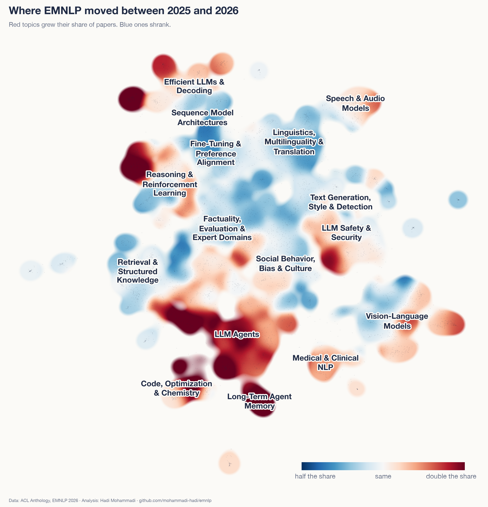
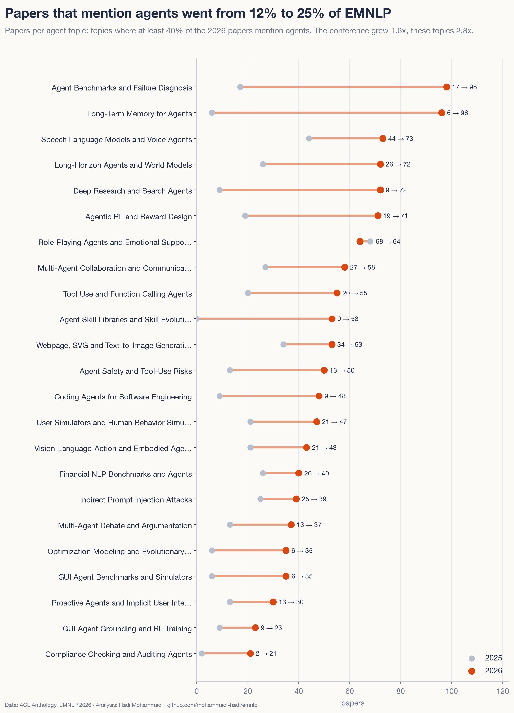
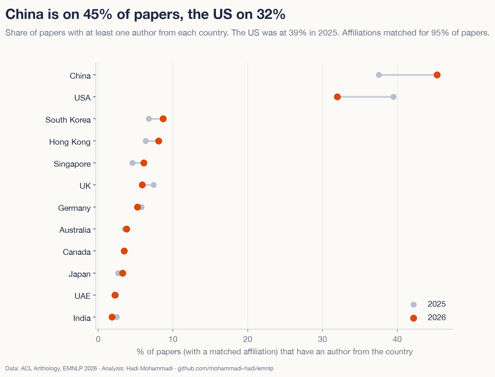

<!-- dek: Every EMNLP 2026 paper on one map, and what changed since 2025. -->
<!-- date: 22 October 2026 -->

# What 5,534 EMNLP 2026 papers are about

EMNLP 2026 in Budapest has 5,534 papers, 59% more than last year. I put all of them on one map and compared them with the 3,484 papers from 2025. The big story is agents.

<!-- atlas-hero -->
**[Open the map of all 5,534 papers →](https://mohammadi.cv/emnlp/2026/atlas.html)**

Each dot is a paper. You can search, zoom in and click any paper to get its PDF and the room and time of its talk or poster.

## What changed

- One in four papers now mentions agents. Last year it was one in eight.
- Memory for agents: 6 papers to 96.
- RL with verifiable rewards went from 3 papers to 89.
- "Benchmark" is in 47% of papers, up from 37%.
- Linguistics, multilinguality and translation fell from 9.8% to 7.0% of papers.
- More papers have an author in China (45%) than in the US (32%). Last year the two were about level.

Same map, new colours. Red parts grew their share since 2025 and blue parts shrank, and the agent corner at the bottom is the clearest red block.

Most of these papers test agents or try to make them work on longer tasks. Benchmarks for agents went from 17 papers to 98, and agents that search the web and write reports went from 9 to 72.

## Who wrote the papers

Of the papers where I could match an affiliation, 45% have an author in China, up from 38%. The US went from 39% to 32%. Alibaba is on the most papers (251), followed by Tsinghua University (227).

If you are going to Budapest, plan for Monday 26 October. It is the busiest day, with 1,761 papers.

## How I made it

All the data is public. Titles, abstracts and authors come from the ACL Anthology, and the rooms and times from the EMNLP program. An open model, Qwen3-Embedding-0.6B, turned each paper into numbers. Then I grouped similar papers into 100 topics. Each 2025 paper went into its closest 2026 topic, so both years are measured the same way. It is the same method as my [NeurIPS 2026 map](https://mohammadi.cv/neurips/2026/).

Topics are a rough lens. I re-ran the grouping two other ways and the rise of agents showed up every time. The 2026 papers come from the Anthology before its official release, so a few titles, authors or affiliations may still change, and until the paper pages go live each paper links to its PDF.

## Explore

[The map](https://mohammadi.cv/emnlp/2026/atlas.html) · [All papers with rooms and times](https://mohammadi.cv/emnlp/2026/papers.html) · [All topics](https://mohammadi.cv/emnlp/2026/charts/treemap.html) · [Appendix](https://mohammadi.cv/emnlp/2026/appendix.html) · [Code and data](https://github.com/mohammadi-hadi/emnlp)

Hadi Mohammadi · [mohammadi.cv](https://mohammadi.cv)
